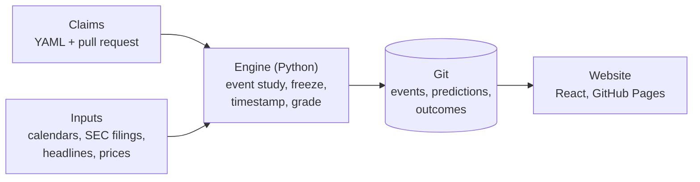

<p align="center">
  <a href="https://github.com/McMuf/Spillover">
    
  </a>
</p>

<h1 align="center">Spillover</h1>

<p align="center">
  <a href="https://github.com/McMuf/Spillover/releases"></a>
  <a href="https://doi.org/10.5281/zenodo.24409543"></a>
  <a href="LICENSE"></a>
  <a href="#data-and-licensing"></a>
  
  
</p>

<p align="center">
  <b>An open ledger that tests how news spills over into markets.</b><br>
  <a href="https://mcmuf.github.io/Spillover/"><b>Live site</b></a> ·
  <a href="#quick-start"><b>Run it locally</b></a> ·
  <a href="docs/methodology.md"><b>Methodology</b></a>
</p>

Spillover is a market research tool for hobbyists, students and curious people. You make your assumptions regarding a particular headline or news event's influence on the
market, and your claim gets locked into the system with a time stamp. After that, real market information determines if you got it right. Spillover does not place any trades and send any signals. Each claim ends up on a scoreboard which will also contain its sample size,
uncertainty and errors. Users can challenge a claim, comment on it and share their opinions
regarding a particular claim or outcome.

> [!NOTE]
> **Alpha, live since November 16, 2026.** The engine, ledger, news feed and site run on real data.
> Nothing has been graded yet: the first forward predictions are graded after their events in December
> 2026. Rules 0.2 (November 20) fixed statistical problems found by an outside review before any grading
> ([what changed](docs/methodology.md#rules-changes)). Research, not investment advice.

## What it does

- **Guided claim form.** Seven short steps take you from a news story to a testable claim, with no finance
  background needed. Fixed, readable rules (not an AI) flag vague ideas: questions, missing directions,
  hedging, one-off stories and price targets.
- **Backtest first.** An event study over past events of the same kind shows whether there is anything
  worth testing, with a 95% interval.
- **Frozen predictions.** When a new qualifying event appears, the engine writes a prediction before its
  window closes, hashes it and anchors it in Bitcoin with OpenTimestamps, so nobody can claim hindsight.
- **Graded in public.** After enough new events, the claim is Supported, Not supported or Inconclusive.
  Misses stay on the record.
- **Check-ins** at 1 week, 1 month, 6 months, 1 year and 5 years show longer-term trends. They are never
  part of the grade.
- **News tab** with the latest market headlines (via GDELT). Any headline can start a pre-filled claim.
- **Counter-claims, challenges and replications**, grouped on each claim's page.
- **Fair ordering.** Lists are sorted by facts anyone can check, never by votes.
- **Citable.** Every claim page gives a reference or BibTeX entry for the exact version, and releases are
  archived on Zenodo ([10.5281/zenodo.24409543](https://doi.org/10.5281/zenodo.24409543)).
- **Free to run.** A static site on GitHub Pages, scheduled GitHub Actions, and Git as the database.

## How a claim works

1. **Draft.** Fill in the form on the site (or copy `claims/_template.yaml`) and open a pull request.
   Review checks only that the claim can be tested, never whether the idea is good.
2. **Register.** On merge, CI stamps `registered_at`. From then on the claim is frozen; a change is a new
   version (`_v2`) and its counter starts at zero.
3. **Collect.** Each new qualifying event creates a frozen, hashed, timestamped prediction.
4. **Verdict.** The verdict uses exactly the first N new events the claim asked for (at least 8).

```yaml
id: clm_fomc_abs_move_spx_v2
statement: >
  On FOMC decision days, the S&P 500 makes a larger absolute move over the day and the next
  trading day than it does on ordinary days (by rank among ordinary windows of the same length).
event_type: FOMC_DECISION
trigger_entities: [FED]
instrument: {venue: us_index, symbol: SPX}
window: {start: first_report, end: +1_trading_day}
expected_sign: positive
baseline: constant_mean
measure: abs_excess_return
success: {spillover_ci_excludes_zero: true, min_forward_events: 8}
falsifier: >
  After 8 forward FOMC decisions, the interval for the move's size rank includes the typical
  50% or lies below it.
```

## Scoring rules

Applied the same way to every claim. A rule change needs a 7-day comment window and applies only to
claims registered afterwards.

- **Baseline** Each event is compared with what a normal day predicts, estimated over 120
  trading days that end 10 days before it, leaving out other scheduled news days.
- **Independent events.** Overlapping windows count once, and events next to other scheduled news are
  dropped.
- **Honest intervals.** A Student t-interval, checked by simulation to be wrong about 5% of the time with
  8 events. Bigger-move claims are tested on the size rank of the move.
- **Fixed stopping and many-claims correction.** No re-checking until it looks good, and p-values are
  adjusted across claims (Benjamini-Hochberg).
- **Controls.** A random-dates placebo should show nothing; Fed days and S&P 500 swings should show
  something. If either fails, the engine is wrong.

Details and references: [docs/methodology.md](docs/methodology.md).

## Architecture

Git is the database, Python is the engine, and the site is a static build that reads the engine's
output. There is no server and no secret in the browser. The site's
[Architecture tab](https://mcmuf.github.io/Spillover/#/architecture) walks through each part.



| Choice | Why |
|---|---|
| Git as the database | Pre-registration needs a public history nobody can quietly rewrite |
| Static site | No hosting bill and no server to attack |
| One schema | Pydantic models generate the JSON Schema and the site's TypeScript types |
| Scheduled CI | GitHub Actions jobs commit results back to `main`, replacing a backend |

**Stack:** Python 3.12, uv, Pydantic, Polars, DuckDB, statsmodels, scipy and Typer for the engine;
React, TypeScript, Vite, Tailwind, Radix and Lightweight Charts for the site; pytest, pyright, Vitest,
Playwright and axe-core for tests; GitHub Actions, GitHub Pages and OpenTimestamps for infrastructure.

**Event labelers.** Headlines become typed events through phrase rules (the default), a small open model
(MiniLM) that runs locally, or optionally Claude. People label a sample by hand on the site, and accuracy
is published only once that set holds at least 20 real events.

## Data and licensing

Code is Apache-2.0; claims, events, predictions and outcomes are CC-BY-4.0. Contributions use a DCO
sign-off (`git commit -s`). Only derived statistics are stored or shown, never raw prices or article text.

| Source | Used for | Terms |
|---|---|---|
| [FRED](https://fred.stlouisfed.org/) | S&P 500, Nasdaq Composite, dollar and yen series | Index series are copyrighted and used for non-commercial educational research only; the rest are public domain |
| [Tiingo](https://www.tiingo.com/) | Daily adjusted closes for 11 large US stocks | Free plan with the maintainer's key |
| Fed and BLS calendars | Fed, CPI and jobs-report dates | Public |
| SEC EDGAR | Company events from 8-K item numbers | Public domain |
| [GDELT](https://www.gdeltproject.org/) | Headlines for the News tab (shown only) | Free with citation |
| Wikidata | Company names for the labeler | CC0 |

Anyone reusing this commercially needs permission from S&P Dow Jones Indices and Nasdaq, or other sources.

## Quick start

```bash
git clone https://github.com/McMuf/Spillover.git
cd Spillover
make setup       # installs uv and dependencies; no API keys needed
make check       # lint, strict types, tests, schema validation
make test-claim CLAIM=claims/clm_fomc_abs_move_spx_v2.yaml
make site        # the website at http://localhost:5173 (needs pnpm)
```

The bundled fixtures are synthetic, so local reports show the machinery working, not facts about real
markets. For live data, copy `data/sources.example.toml` to `data/sources.toml`, set your own
`FRED_API_KEY`, and run `make ingest`.

## Contributing

Contributions come in five lanes: claims, challenges, replications, code, and docs or labels. See
[CONTRIBUTING.md](CONTRIBUTING.md) for the flow and checklist, [GOVERNANCE.md](GOVERNANCE.md) for how
decisions are made, and the [Code of Conduct](CODE_OF_CONDUCT.md). Registered claims and generated files
cannot be edited by hand; CI blocks it.

**Security.** Pull requests from forks run with a read-only token and no secrets, the comment bot never
runs pull-request code, and actions are pinned to commit hashes. Report vulnerabilities privately through
the Security tab ([SECURITY.md](SECURITY.md)).

## Roadmap

- **Built:** engine, ledger and timestamps, scoring, the site, News tab, guided claim form, label page,
  discussion threads, profiles and the Questions board.
- **Live claims:** seven under rules 0.2: two controls, four on Fed, CPI and jobs-report days, and one on
  CrowdStrike and acquisitions.
- **Next:** more single-stock claims, crypto and perpetual-future prices, sign-in without GitHub, and
  backing or doubting claims (reputation only, never money).

## FAQ

**Is this a trading tool?** No. It places no trades and publishes no recommendations.

**Why not just backtest?** Backtests can be tuned until they win. A claim frozen before the outcome
cannot.

**Can a failed claim be deleted?** No. It stays on the record with its result.

**Does "Supported" mean I should trade it?** No. Costs, slippage, risk and changing markets are not
modeled.

## License

Code under [Apache-2.0](LICENSE), claims and data under CC-BY-4.0. See [`NOTICE`](NOTICE) for
attributions, including TradingView Lightweight Charts. Spillover is independent and not affiliated with
any exchange, broker, data vendor or company named in it; logos belong to their owners. Nothing here is
investment advice.
