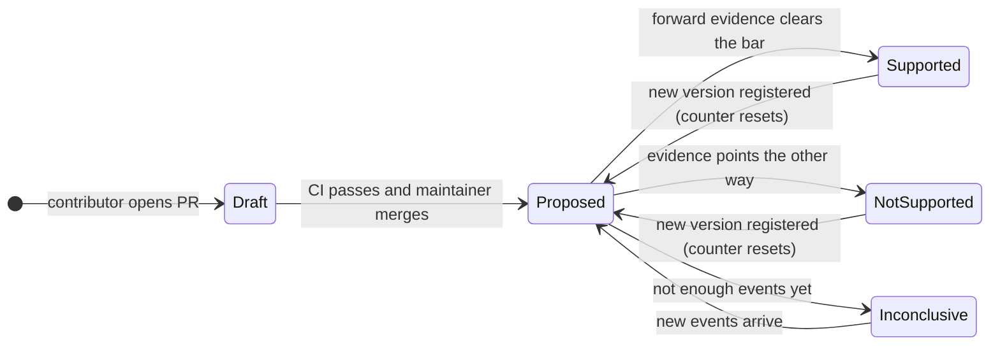

<p align="center">
  <a href="https://github.com/McMuf/Spillover">
    
  </a>
</p>

<h1 align="center">Spillover</h1>

<p align="center">
  <a href="https://github.com/McMuf/Spillover/releases"></a>
  <a href="https://github.com/McMuf/Spillover/stargazers"></a>
  <a href="LICENSE"></a>
  <a href="#data-licensing-and-sources"></a>
  
  
  
</p>

<p align="center">
  <b>An open, community-run ledger that tests how news spills over into markets.</b><br>
  Anyone can write a claim like "when X happens, Y moves." The claim is frozen before the outcome, then graded against what the market actually did.
</p>

<p align="center">
  <a href="https://mcmuf.github.io/Spillover/"><b>See the live demo</b></a> (synthetic data) ·
  <a href="#quick-start"><b>Run it locally</b></a>
</p>

<p align="center">
  <a href="#what-it-can-do">What it can do</a> ·
  <a href="#how-a-claim-lives-and-dies">How it works</a> ·
  <a href="#the-node-language">Node language</a> ·
  <a href="#screens-and-user-experience">Screens</a> ·
  <a href="#architecture">Architecture</a> ·
  <a href="#contributing">Contributing</a> ·
  <a href="#roadmap">Roadmap</a> ·
  <a href="#faq">FAQ</a>
</p>

Spillover is a **market research tool for hobbyists, students and curious people**. It is not a trading bot, a signal service or a price predictor. It is a public notebook with a referee: you write down what you think a headline will do to a market, the system locks that statement in with a timestamp, and later the market decides whether you were right. Every claim ends up on a public scoreboard with its sample size, its uncertainty and its failures shown.

> [!NOTE]
> **Status: alpha, pre-launch.** The data model, scoring rules and screens in this document are the design the first milestone builds against. Anything marked *planned* is not shipped yet. Spillover is **research, not investment advice**, and nothing here is a recommendation to buy or sell anything.

<details>
<summary><b>Table of contents</b></summary>

- [What it can do](#what-it-can-do)
- [Included](#included)
- [Why this exists](#why-this-exists)
- [Who it is for](#who-it-is-for)
- [How a claim lives and dies](#how-a-claim-lives-and-dies)
- [The node language](#the-node-language)
- [Screens and user experience](#screens-and-user-experience)
- [Scoring rules](#scoring-rules)
- [Architecture](#architecture)
- [Tech stack and rationale](#tech-stack-and-rationale)
- [Data, licensing and sources](#data-licensing-and-sources)
- [Quick start](#quick-start)
- [Contributing](#contributing)
- [CI and fork security](#ci-and-fork-security)
- [Governance](#governance)
- [Roadmap](#roadmap)
- [Limits, risks and how they are handled](#limits-risks-and-how-they-are-handled)
- [FAQ](#faq)
- [Community and support](#community-and-support)
- [Developing](#developing)
- [Contributors](#contributors)
- [License](#license)

</details>

## What it can do

- **Register a claim in a YAML file.** A claim names a trigger (a type of headline), an instrument (a stock, ETF, index or perpetual future), a time window, an expected direction and a success rule. Opening a pull request is how you submit it.
- **Backtest it before you commit.** The engine runs an *event study* over 3 to 5 years of history: it finds past events of that type, measures what the instrument did beyond what the broader market explains, and reports the result with an honest interval.
- **Freeze live predictions.** When a new qualifying headline appears, the engine writes a prediction, hashes it, and commits it to an append-only ledger *before* the window closes. Bitcoin-anchored timestamps (OpenTimestamps) make the commit time hard to fake.
- **Grade against reality.** After the window closes, the engine scores the call against the realized abnormal return and a naive baseline. Wins and misses are both published.
- **Show the reasoning as a graph.** A fixed visual language of six node types, each with its own shape and tag, turns a claim into a readable map with no ambiguity about what any shape means.
- **Challenge and replicate.** Anyone can open a challenge against a claim or replicate it with different data. Challenges and replications are first-class, reviewed contributions.
- **Publish a calibration scoreboard.** Per claim and per contributor: hit rate, effect size, sample size, intervals, and a calibration plot. The scoreboard is generated, never hand-edited.
- **Run entirely on free infrastructure.** A static site on GitHub Pages, a scheduled GitHub Action for the engine, and Git as the database.

## Included

- **[Claim files](claims/):** One YAML file per claim, validated by a JSON Schema generated from the Python models. The template lives at `claims/_template.yaml`.
- **[Event extractor](#4-event-extractor):** Turns a raw headline into a typed event (what happened, to whom, when) using an LLM with strict structured output, a cache and a hand-labeled gold set.
- **[Event-study engine](#5-event-study-engine):** Market model, abnormal returns, cumulative abnormal returns, bootstrap intervals and false-discovery-rate correction.
- **[Prediction ledger](#6-prediction-ledger-and-timestamps):** Append-only, hashed, timestamped records of every forward call.
- **[Scoring and calibration](#7-scoring-and-calibration):** Public rules, applied identically to everyone.
- **[Claim chains and the news map](#8-claim-chains-and-the-news-map):** each claim drawn as a readable chain (who → what happens → which market), and a news-by-market map of every claim.
- **[Web app](#9-web-app):** A calm, finance-app-style interface with dark and light themes, built in TypeScript.
- **[Contribution tooling](#contributing):** `make` targets, issue forms and CI checks, including a trusted bot comment on every pull request, that give contributors fast, specific feedback.
- **Docs:** Methodology, governance, contributor guidance and data-source terms, kept by the maintainers.

## Works with

`Python 3.12+` · `uv` · `Pydantic v2` · `Polars` · `DuckDB` · `Parquet` · `statsmodels` · `Typer` · `React` · `TypeScript` · `Vite` · `Tailwind` · `TradingView Lightweight Charts` · `GitHub Actions` · `GitHub Pages` · `OpenTimestamps`

## Why this exists

Finance news is full of confident stories: "chipmaker X missed, so suppliers will fall," "the Fed spoke, so tech sells off." Most of these are never checked. Two things make them hard to check:

1. **The vague-claim problem.** "Tech might struggle" cannot be wrong. A checkable claim states the trigger, the instrument, the window and the direction up front.
2. **The hindsight problem.** After the move happens, almost any story fits. A claim only counts if it was written down, with a trustworthy timestamp, *before* the outcome.

Spillover is built around fixing exactly those two problems in public, with open code, open data and open review.

It also treats a third problem as a first-class feature: **most market moves are already explained by the market.** If the whole index is down 1% and your stock is down 1.1%, the headline did not do much. The engine therefore always compares against a **naive baseline** (what a simple model driven by the broader market and sector would have predicted) and reports the *abnormal* part.

### Honest prior art

| Project or field | What it does | How Spillover differs |
|---|---|---|
| Event-study research (academic) | The standard method for measuring how news moves prices | Spillover uses the same method but makes claims public, pre-registered and community-written |
| News-analytics vendors (e.g. RavenPack, Dataminr) | Commercial event extraction and sentiment feeds | Closed, paid, and not built for open claim-by-claim scoring |
| LLM and knowledge-graph papers on news propagation | Often simulation-only or retrospective | Spillover scores forward, frozen predictions against real outcomes |
| Aftershock-style event-study sites | Live event studies on specific themes such as geopolitics | A site for reading, not a community framework for contributing and grading new claims |
| Numerai | Crowdsourced stock predictions | Hedge-fund oriented and token-incentivized; Spillover is a transparent research commons |
| Quantopian (shut down in 2020) | Community backtesting platform | Spillover emphasizes pre-registration and forward grading over backtest optimization |
| Open-source replication projects in academic finance (e.g. Chen and Zimmermann) | Reproduce published return predictors | Closest in spirit; Spillover is aimed at news-driven claims and hobbyist contribution |
| OpenBB | Open-source terminal for market data | A data and research terminal; Spillover is a ledger of falsifiable claims |

> [!IMPORTANT]
> The claim here is **not** "nobody has combined these ideas." The claim is narrower and checkable: as of this writing, no project found combines (a) typed, falsifiable news-to-market claims, (b) public pre-registration with anchored timestamps, (c) forward grading against a naive baseline, and (d) a standard fork-and-pull-request contribution flow for hobbyists. If you know of one, please [open an issue](https://github.com/McMuf/Spillover/issues) so it can be credited here.

## Who it is for

| Person | What they want | What Spillover gives them |
|---|---|---|
| **The curious hobbyist** | "I think X moves Y. Am I right?" | A guided template to write the claim, a fast feasibility check, and a public verdict later |
| **The student** | A real project with real data and a real reviewer | A portfolio-ready contribution with a permanent, citable record |
| **The skeptic** | Evidence that popular market narratives hold up (or don't) | Replications, placebo tests and challenges as first-class actions |
| **The data and quant hobbyist** | Interesting methodology problems | A clean engine, a rules file, and open issues for better estimators |
| **The educator** | A hands-on way to teach event studies and p-hacking | A living example where the scoring rules prevent most common mistakes |
| **The frontend contributor** | A well-scoped design problem | A typed component library, a strict visual language and a Storybook-style starter set |

**Not for:** people looking for trade signals, anyone wanting automated execution, or anyone who needs guaranteed-accurate real-time prices. Spillover never places trades and never holds funds.

## How a claim lives and dies



1. **Draft.** You copy `claims/_template.yaml`, fill it in and run `make test-claim CLAIM=claims/your_claim.yaml`. The engine reports whether enough historical events exist to say anything at all.
2. **Proposed.** After review (for clarity and testability only, never for whether the idea is "good") the claim is merged. CI stamps `registered_at`. From this moment, forward events count.
3. **Forward log.** Each qualifying live headline creates a frozen prediction. Predictions are hashed and committed before the window closes.
4. **Verdict.** Once the claim has enough forward events (set in the claim itself, with a floor in the rules file), it moves to **Supported**, **Not supported** or stays **Inconclusive**. Verdicts are never deleted.
5. **Versioning.** Changing a claim's trigger, instrument, window or success rule creates `_v2`. The forward counter resets to zero. Old versions stay visible so nobody can quietly edit their way to a win.

### Example claim

```yaml
id: clm_bigtech_fcf_mags_v1
statement: >
  After a headline that a Magnificent 7 company's quarterly free cash flow turned negative,
  the MAGS basket falls by more than the headline company's weight explains.
event_type: FCF_TURNS_NEGATIVE
trigger_entities: [GOOGL, MSFT, AMZN, META, AAPL, NVDA, TSLA]
instrument: {venue: us_equity, symbol: MAGS}
window: {start: first_report, end: +1_trading_day}
expected_sign: negative
decompose: [mechanical_weight, spillover]
baseline: factor_only
success: {spillover_ci_excludes_zero: true, min_forward_events: 8}
falsifier: >
  Spillover estimate within +/- 0.1 percentage points of zero after 8 forward events.
registered_by: github_handle
registered_at: set_by_ci_on_merge
```

Reading it aloud: *"When a Magnificent 7 company's free cash flow turns negative, the MAGS basket falls over the next trading day by more than that company's index weight alone would cause. I will call this supported if the spillover part's interval excludes zero after at least eight forward events."*

The `decompose` field matters. If one member is 20% of an index and drops 5%, the index mechanically falls about 1% with no spillover at all. Spillover separates **mechanical weight** from **spillover**, so a claim cannot get credit for arithmetic. *Not implemented yet: it needs index-weight data, and the engine refuses a claim that sets it rather than guess.*

Two optional fields widen what a claim can test:

- **Baskets.** `instrument: {venue: us_equity, symbol: AI_SUPPLIERS, basket: [NVDA, AVGO, MU, ANET]}` tests an equal-weighted basket (2 to 50 members, rebalanced daily): its daily return is the average of its members' returns.
- **Several factors.** `factors: [BTC, ETH]` (up to 3) replaces the single `factor`, so the baseline becomes `alpha + beta₁ × BTC + beta₂ × ETH`. Use it when one market factor would leave obvious common moves in the result, as with crypto tokens that track both BTC and ETH.

Neither field appears in a frozen prediction unless the claim uses it, so records written before these fields existed keep their exact bytes and hashes.

## The node language

The graph is the product's face, so it follows one rule: **if a shape could mean two things, the design is wrong.** Six node types, each with a fixed shape, a three-letter tag printed on the node, and a plain-English definition in the always-visible legend.

| Shape | Tag | Node type | Means exactly | Example | Must have |
|---|---|---|---|---|---|
| ■ Square | `EVT` | **Event** | One dated, sourced thing that happened | "Company X reports negative free cash flow, 2027-02-04" | Timestamp, source link |
| ● Circle | `ENT` | **Entity** | A company, person, country or institution | "Alphabet" | Stable ID, name |
| ◆ Diamond | `INS` | **Instrument** | A thing you can look up a price for, labeled with where it trades | "GOOGL · Nasdaq" vs "GOOGL · perp" | Venue, symbol |
| ⬡ Hexagon | `FAC` | **Factor** | A broad driver the engine controls for | "US equity market", "semiconductor sector" | Series definition |
| ▲ Triangle | `CON` | **Condition** | A rule that must hold for the claim to apply | "Report is the company's first of the quarter" | Machine-checkable rule |
| ★ Star | `PRD` | **Prediction** | A frozen, hashed forward call | "Predicted: MAGS below baseline, +1 day" | Hash, timestamp, claim version |

### Edge rules

- **Every numeric edge shows five things:** the estimate, its interval, the sample size, the window and the as-of date. No bare numbers.
- **Green and red mean direction, as on any market screen.** A number above zero is green, below zero is red, and every colored number also carries its sign, so color is never the only cue. A backtest estimate in green is still a backtest: the label next to it always says so. Verdicts (Supported, Not supported) use the same colors plus a ✓ or ✕ and the word itself.
- **Blue is the one highlight color** for links, the active tab, names picked out in headlines and chart lines. Blue stays distinct from green and red for readers with red-green color blindness.
- **A node without a source cannot exist.** Events need a link; instruments need a data source; factors need a series definition.
- **Index membership is its own edge type** (`weight`), drawn differently from `spillover`, so mechanical effects and real effects never share a line.
- **The graph is capped at about 40 nodes** per view. Past that, the view collapses into a table. A graph nobody can read is decoration.
- **Dashed edges are untested or low-sample.** Solid edges have passed the minimum-evidence rule.

### Same instrument, different venue

Because many assets trade in more than one place (a stock on an exchange, a perpetual future on a crypto venue), an **Instrument** node always shows its venue. "GOOGL · Nasdaq" and "GOOGL · perp" are separate nodes with separate data, separate trading hours and separate behavior outside market hours. Claims about weekend or after-hours moves are always venue-specific.

## Screens and user experience

> [!NOTE]
> Wireframes below are ASCII sketches of intent, not final designs. The visual direction is a **calm finance-app feel**: a black page, flat panels, tabular numerals, one dark theme and tabs on detail pages. Spillover does **not** copy any commercial app's branding, typeface, interface icons or screenshots.

### Design principles

1. **Evidence before opinion.** Every number has its sample size next to it.
2. **Two seconds to the verdict.** Each claim card leads with a status badge, the one-line statement and the evidence meter.
3. **Time is a first-class axis.** Charts mark the event with a vertical dashed line and shade the estimation and event windows.
4. **Direction, not judgment.** Green and red say which way a number moved; whether a claim was right is said in words (Supported, Not supported, Inconclusive) and only after the window closes.
5. **Mobile first.** Most hobbyists will check this on a phone. Desktop gets a side sheet; mobile gets a bottom sheet.
6. **Accessible by default.** WCAG AA contrast, keyboard-reachable graph, text alternatives for every chart (a table view is always one tab away).
7. **No dark patterns.** No streaks, no "hot claims," no red-dot urgency. This is a research tool.

### Screen 1: Claims map (home)

```text
┌──────────────────────────────────────────────┐
│ Spillover                  [Search claims…]  │
│ Claims · Events · Scoreboard · Submit        │
├──────────────────────────────────────────────┤
│ Filters: All ▾  Status ▾  Instrument ▾  Venue▾│
│                                              │
│ ┌──────────────────────────────────────────┐ │
│ │ SUPPORTED   clm_semis_korea_us_v1        │ │
│ │ Large Korean memory-chip moves lead US   │ │
│ │ ADRs and Micron next session             │ │
│ │ Evidence ▓▓▓▓▓▓▓░░░  14 of 20 events     │ │
│ │ ◆ MU · Nasdaq   ◆ Memory ADR basket            │ │
│ └──────────────────────────────────────────┘ │
│ ┌──────────────────────────────────────────┐ │
│ │ INCONCLUSIVE  clm_bigtech_fcf_mags_v1    │ │
│ │ …                                        │ │
│ └──────────────────────────────────────────┘ │
│ [ Show as graph ]                            │
└──────────────────────────────────────────────┘
```

- **Cards** are the default view (fast, accessible, mobile-friendly). The **graph** is one toggle away.
- **Evidence meter** shows forward events collected versus required, so "Inconclusive" reads as "not enough data yet," not "failed."
- **Instrument chips** always include the venue.

### Screen 2: Claim page (tabs)

Tabs: **Overview · Evidence · Forward log · Challenge**

| Tab | Shows | Why it exists |
|---|---|---|
| **Overview** | Statement in plain English, status badge, effect size with interval, the mini graph, the YAML in a collapsible block | A non-expert can understand the claim in ten seconds |
| **Evidence** | Event-window chart (price indexed to 100, event line, shaded windows), distribution of abnormal returns, table of every historical event, placebo comparison | Lets a skeptic audit the claim |
| **Forward log** | Every frozen prediction with its hash, timestamp, status (open, closed, graded) and outcome | The pre-registration proof |
| **Challenge** | Open challenges, replications, and a button to start one | Makes disagreement a structured activity |

A claim detail page on mobile keeps a **sticky footer** with the two most useful actions: *Challenge* and *Copy citation*. (Spillover has no trade buttons; nothing on the site executes a trade.)

### Screen 3: Event page

One event: the headline, source links (title and URL only), the extracted structure (event type, entities, timestamp), the extractor's confidence, a **Needs review** label if confidence is low, and every claim that fired on it with its frozen prediction and, later, its outcome.

Why: events are shared inputs. One earnings headline can trigger several claims, and readers should see them side by side.

### Screen 4: Submit a claim

A guided form that generates the YAML and validates it live against the engine's own JSON Schema. A **feasibility check** (how many historical events match, how many are independent with overlapping windows removed, and whether the claim is testable at all) needs the engine, which does not run in the browser: *today the form tells you to run `make test-claim` locally; an in-browser check is planned.*

Fields: statement (plain English), event type (dropdown from the taxonomy), instrument (searchable, venue required), window (presets plus custom), expected sign, success rule (presets), and a "what would prove me wrong?" line that is mandatory.

The form ends with *Open pull request*, which pre-fills a branch name and a PR body containing the checklist.

### Screen 5: Scoreboard

- Per claim: status, effect size, interval, events, whether it beat the naive baseline.
- Per contributor: claims registered, share supported, **calibration plot** (stated confidence versus realized hit rate), and an explicit note on small samples.
- A permanent **Placebo** row: a claim on random dates that should show nothing. If the placebo ever "works," the engine has a bug, and the site says so.

### Also built

- **Method page** (`#/method`): the steps behind every number, what each status means, what the method cannot tell you, a glossary, and a reading list of standard references. A test fails if its constants (estimation window, gap, bootstrap size) drift from the engine's.
- **Embed widget:** every claim page has an "Embed this claim" box with a one-line `<iframe>` snippet. It shows a read-only card (status, evidence meter, backtest label, the not-advice line) with no site chrome, and links back. Checked in a browser by framing it on a separate page.

### Later screens (planned)

- **What-if mode:** pick a claim, enter a hypothetical position size and leverage, and see a *liquidation distance* in plain language. Educational only; no execution. Not built: correct margin rules differ by venue and a wrong number would mislead.
- **Per-claim-family reading lists:** the Method page has the general references; curated lists per claim family need a person's judgment.

### Visual system starter set

| Component | Purpose |
|---|---|
| `ClaimCard` | Status badge, statement, evidence meter, instrument chips |
| `StatusBadge` | Proposed, Supported, Not supported, Inconclusive |
| `NodeLegend` | Always-visible legend for the six node shapes |
| `EventWindowChart` | Price chart with event line and shaded windows |
| `ForwardLogTable` | Frozen predictions with hash and outcome |
| `CalibrationPlot` | Stated versus realized hit rate |
| `EvidenceMeter` | Events collected versus required |
| `InstrumentChip` | Symbol plus venue, never one without the other |

Design tokens (colors, spacing, type scale) live in `web/src/design/tokens.ts` and are the single source for the site's one dark theme. Contributors improve the system by changing tokens and components, not by adding one-off styles.

## Scoring rules

The rules below are applied identically to every claim. Changes need a **7-day public comment window** and apply **only to claims registered after the change**, so nobody's claim is graded under rules they did not sign up for.

1. **Pre-registration.** Only events that occur after `registered_at` count as forward evidence. Backtests are labeled as backtests everywhere in the UI.
2. **Frozen predictions.** A prediction is written, hashed and committed before its window closes, and records the claim version, extractor version and engine version.
3. **Fixed definitions.** Trigger, instrument, window, sign and success rule cannot change within a version. Changing any of them creates a new version and resets the counter.
4. **Naive baseline.** Every claim is scored against a factor-only baseline. Beating zero is not enough; the claim must beat what the market and sector already explain.
5. **Independent events.** Overlapping windows are collapsed. Scheduled-event windows (such as central-bank decisions) that overlap an event are excluded or flagged. The **effective** sample size is what counts.
6. **Multiple-comparison control.** Because many claims are tested, results are adjusted with a false-discovery-rate procedure across the set of claims. A single lucky claim does not get a free pass.
7. **Permanent placebo.** A random-dates claim runs forever. If it shows significance more often than chance allows, the engine is treated as broken until fixed. Its dates are drawn **in advance** (`spillover placebo-events`, deterministic from a public seed, one file per future month, never rewritten), so a placebo date is committed before it happens exactly like a real forward event. The placebo claim (`clm_placebo_random_dates_v2`) trades the Nasdaq Composite against the S&P 500, both from FRED, so the scoring job can price it. Version 1 traded a sector ETF the job had no price source for; it stays on record as registered and is superseded. A claim is superseded as soon as a newer registered version of it exists (`_v2` replaces `_v1`), and from then on it collects no new predictions. The twelve placebo dates frozen for `_v1` on the first live run, before that rule existed, stay in the ledger as they are: append-only means nothing is removed, and with no price source they simply stay open. A claim whose prices are missing is left open and reported as "no data" instead of failing the run, and a test fails if a live claim cannot be priced from the CI config.
8. **Append-only history.** Verdicts, predictions and outcomes are never edited or deleted. Corrections are new records that link to the old ones.

### Status thresholds

| Status | Meaning |
|---|---|
| **Proposed** | Registered, with fewer effective forward events than the claim's minimum (still collecting) |
| **Supported** | Forward events reached the claim's minimum, the interval excludes zero in the stated direction, and the claim beat the naive baseline after multiple-comparison adjustment |
| **Not supported** | Forward events reached the minimum and the interval excludes zero in the **opposite** direction |
| **Inconclusive** | Forward events reached the minimum but the interval includes zero, or the result did not survive the multiple-comparison adjustment |

The statistics: the market model (alpha plus beta times a factor return, estimated over roughly 120 trading days that end 10 days before the event), cumulative abnormal returns, bootstrap intervals, and why each choice was made.

## Architecture

Spillover is a **file-first, static-first** system. Git is the database, Python is the engine, and the website is a static build that reads the engine's output. There is no server to run, no database to administer and no secret in the browser.

```mermaid
flowchart LR
    subgraph Contribute["Contribution"]
        C1["Claim YAML<br/>claims/*.yaml"]
        C2["Pull request<br/>fork and PR flow"]
    end

    subgraph Inputs["Inputs"]
        N1["Headline feed<br/>titles, links, IDs, times"]
        P1["Price data<br/>FRED, public APIs,<br/>bring-your-own keys"]
    end

    subgraph Engine["Engine (Python)"]
        E1["Schema validation<br/>Pydantic v2"]
        E2["Event extractor<br/>LLM + cache + gold set"]
        E3["Event-study engine<br/>market model, CAR,<br/>bootstrap, FDR"]
        E4["Prediction ledger<br/>hash + OpenTimestamps"]
        E5["Scoring<br/>public rules"]
    end

    subgraph Store["Store (Git + files)"]
        S1[("events/ predictions/<br/>outcomes/ replications/")]
        S2[("Parquet + DuckDB<br/>cached price data")]
    end

    subgraph Web["Web (TypeScript)"]
        W1["Generated types<br/>from JSON Schema"]
        W2["React app<br/>cards, charts, graph"]
        W3["GitHub Pages<br/>static site"]
    end

    C1 --> C2 --> E1
    N1 --> E2
    P1 --> S2
    E1 --> E3
    E2 --> E3
    S2 --> E3
    E3 --> E4 --> S1
    S1 --> E5 --> S1
    E1 -. "JSON Schema" .-> W1
    S1 --> W2
    W1 --> W2 --> W3
```



### Why this shape

| Decision | Rationale |
|---|---|
| **Git as the database** | Pre-registration needs an append-only, publicly auditable history. Git already gives diffs, authorship, review and mirrors for free. A hosted database would add cost, a trust question and a point of failure. |
| **Static site** | Zero hosting cost, zero ops, no server-side attack surface, easy for contributors to preview locally. |
| **Python engine, TypeScript front end** | Python has the best statistics and data tooling. TypeScript gives type-safe UI. The boundary is a JSON Schema, so the two cannot silently drift. |
| **One schema, generated types** | The Pydantic models are the single source of truth. A build step emits JSON Schema and TypeScript types, so a contributor changing a field gets compile errors in the UI instead of runtime surprises. |
| **Scheduled CI instead of a server** | The engine only needs to run on a cadence (hourly or daily). GitHub Actions on a schedule, writing commits back to `main`, replaces a whole backend. |

### 1. Claims registry

**What it does.** Stores one YAML file per claim and validates it.

**How.** Each claim is parsed into a Pydantic model. A JSON Schema is generated from the same model and published at `schemas/claim.schema.json`, which editors use for autocomplete and CI uses for validation. Claim IDs are immutable and carry their version (`_v1`).

**Why this design.**
- *YAML files over a database table:* a PR diff on a claim is human-readable, reviewable and attributable.
- *Pydantic over hand-written checks:* validation rules (for example, "window end must be after start," "venue is required") are code, tested, and reused by the CLI, CI and the web form.
- *Immutable IDs plus versions:* prevents quiet edits. A changed claim is a new claim.

### 2. Data ingestion

**What it does.** Pulls price and factor series into local Parquet files that the engine reads through DuckDB.

**How.** `spillover ingest` reads `data/sources.toml` and builds a local cache in the same format as the synthetic fixtures, so every command works on real data by pointing `--data` (or `SPILLOVER_DATA`) at it. Built today: **FRED** (bring your own free key, read from `FRED_API_KEY`), **CSV files you export yourself** from any vendor, and the **Federal Reserve's public FOMC calendar** (US government work). Series are aligned on their common trading days before returns are computed, and implausible data (a one-day move over a configurable limit, which is usually an unadjusted split) is refused instead of written. Tests use fixtures and fake fetchers, so CI never needs a live API.

Events come from the FOMC calendar, your own events CSV, and [headline feeds run through the extractor](#4-event-extractor). Live exchange APIs are not included; whether you may use a given vendor's data this way is for you to check in their terms.

**Why this design.**
- *Parquet plus DuckDB plus Polars:* columnar storage is compact and fast for time series, DuckDB queries it with SQL without a server, and Polars gives a fast, readable DataFrame API. This stack is also what many modern data teams use, so contributors' skills transfer.
- *Adapters:* a provider returns a plain date-to-price mapping, so a new source is one small function, which makes it a good first contribution.
- *No raw price redistribution:* the repo stores derived results (returns, estimates), not vendor price files, to respect data terms. See [Data, licensing and sources](#data-licensing-and-sources).
- *Open sources first:* default to sources anyone can use without paying, so contributors can reproduce results.

### 3. Event feed

**What it does.** Collects headline metadata (title, link, source name, timestamp, a stable ID) from permitted feeds.

**Why this design.**
- *Headlines only:* titles, links, IDs and timestamps are enough to define an event and avoid copyright and licensing problems from copying article bodies.
- *Timestamp discipline:* the event time used for scoring is the **earliest verifiable publication time**, not the extraction time. This matters because the window starts at the headline, not at when the engine noticed it.
- *Deduplication:* the same story from fifteen sources is one event with fifteen links, not fifteen events. Otherwise samples would be inflated.

### 4. Event extractor

**What it does.** Converts a headline into a typed event: event type from a fixed taxonomy, entities, and a confidence label.

**Status.** Built and tested with a fake model and the real feed formats. **Not yet run against the live Claude API**, and the 50-headline gold set is **not labeled yet**, so no accuracy number exists. Until it does, treat extracted events as unmeasured.

**How.**
- `spillover ingest-headlines` reads the official feeds in `data/sources.toml` (titles, links, ids and publication times only), skips anything already stored, and sends each new headline to Claude (`claude-haiku-5-5` by default, low effort) with a strict structured-output schema whose event type is an enum of the taxonomy in `engine/spillover/taxonomy.py`. The answer is validated again by Pydantic and rejected if it does not parse. A per-run cost cap (`max_new_per_run`) bounds spend.
- Responses are **cached by content hash** (extractor version, source, title) under `events/extractions/` and committed, so CI is deterministic and fork CI never calls an API. A prompt change changes the version, so old answers are never silently reused. Accepted events are appended to `events/YYYY-MM.jsonl`, which is append-only; the same story from several sources becomes one event when the cache is built.
- A **50-headline hand-labeled gold set** (`labels/gold.jsonl`, labeled by people) measures accuracy with `spillover eval-extractor`; `spillover gold-template` writes unlabeled candidates to label. The report is tied to a hash of the labels and to the extractor version.
- Low-confidence results get a **Needs review** label and are excluded from scoring until a person lists their `event_key` in `labels/confirmed.txt`. Headlines are untrusted text: the schema bounds what a hostile one can make the model output, but a feed you do not trust is still a risk, which is why only official feeds are listed.
- The **extractor version is frozen inside every prediction**, so improving the extractor never rewrites history.

**Why this design.**
- *Taxonomy over free text:* a fixed event-type list is what makes events countable and comparable across claims.
- *Structured output plus validation:* LLMs are fallible; the schema is the guardrail.
- *Cache and gold set:* deterministic tests and a measured, public error rate. Without these, the extraction step would be an unmeasured black box that quietly decides every result.
- *Separate extraction score from market-impact score:* a claim should not be blamed for a mislabeled headline, and the extractor should not be credited for a lucky market move. They are tracked independently.
- *Training-data leakage:* a model may have seen how historical events played out. Gold-set and evaluation headlines are chosen after the model's training cutoff where possible, and backtest results note this limitation.
- *"Fix this label" PR lane:* anyone can correct a wrong label via a small PR, which also grows the gold set.

### 5. Event-study engine

**What it does.** Measures what an instrument did around an event, beyond what the broader market explains.

**How.**
1. Pick the event time and the claim's window.
2. Fit a **market model** over an estimation window of about 120 trading days ending 10 days before the event: `return = alpha + beta × factor_return`, or with up to three factors, `alpha + beta₁ × f₁ + beta₂ × f₂ + beta₃ × f₃`. A basket's return is the equal-weighted mean of its members.
3. Predict the normal return inside the event window and subtract it from the actual return to get the **abnormal return**; sum over the window for the **cumulative abnormal return (CAR)**.
4. Aggregate across events, counting only **effective independent** events.
5. Produce a **bootstrap interval** for the mean abnormal return.
6. Apply **false-discovery-rate correction** across claims.
7. Compare to the **naive baseline** (factor-only) and the **placebo** claim.

**Why this design.**
- *Event study over a raw average move:* a raw move conflates the news with the whole market's day. The market model strips that out. This is the standard, well-understood method, which makes it defensible and easy to review.
- *Estimation window that ends 10 days early:* prevents the event itself from contaminating the "normal" estimate.
- *Bootstrap over textbook t-tests:* returns are fat-tailed and events are few; resampling makes fewer assumptions and handles odd distributions honestly.
- *Effective sample size:* ten headlines in one week about the same story are not ten independent tests.
- *FDR correction:* when many people test many claims, some will look significant by luck. Correcting across the set keeps the scoreboard honest.
- *Placebo:* a permanent control that should always show nothing. If it doesn't, the pipeline is wrong.
- *statsmodels and scipy:* mature, well-tested implementations beat hand-rolled statistics.

### 6. Prediction ledger and timestamps

**What it does.** Records every forward prediction in a way that proves it was made before the outcome.

**How.** Each prediction is a small JSON file containing the claim ID and version, event ID, extractor and engine versions, the predicted sign and window, and a SHA-256 hash of its canonical form. The file is committed to `predictions/`. A scheduled job then submits a salted digest of each prediction file to **OpenTimestamps**, which anchors it in Bitcoin, and stores the proof next to the prediction as `<name>.json.ots`. Stamping each file (rather than the commit) keeps every record independently verifiable. A new proof is *pending* until Bitcoin confirms it (usually hours); a later run upgrades it. A prediction is only written for an event whose window is still open, so the ledger cannot be backfilled with hindsight.

**Why this design.**
- *Why not just Git commit times:* commit timestamps are set by the committer and can be rewritten. A Bitcoin-anchored proof shows the record existed no later than a given block, independent of GitHub and of the maintainer.
- *Hashing the canonical form:* any later edit changes the hash, so tampering is detectable by anyone with the repo.
- *Append-only:* corrections are new records. This is what makes the ledger trustworthy rather than merely tidy.
- *OpenTimestamps over a blockchain product:* it is free, open, needs no wallet or token, and a proof file is a few hundred bytes.

### 7. Scoring and calibration

**What it does.** After a window closes, joins each prediction to realized data, grades it, and updates claim statuses and the scoreboard.

**How.** A pure function from (prediction, outcome, rules version) to a score record, written to `outcomes/`. Aggregation reads only those records. The rules version is stored in every score record. A prediction written after its window closed is refused, and a prediction that fails hash verification is never graded. Corrections are new records that point at the old one; the old record stays. Scoring rules 4 to 6 are applied when aggregating: scheduled-event overlaps are excluded, overlapping windows are collapsed, and p-values are adjusted across claims. Where a claim states a confidence, the scoreboard compares it with the realized hit rate (calibration); claims that state none are left out of that plot. A placebo claim that shows a significant result raises a visible alert. *Built and tested on fixtures; not yet run on live data, because live ingestion is not built.*

**Why this design.**
- *Pure functions:* trivially testable, and anyone can recompute the scoreboard from the repo and get the same numbers.
- *Rules version in each record:* grading is reproducible under the rules that applied when the claim was registered.
- *Calibration plot, not just hit rate:* a 60% hit rate means little without knowing how confident the claim was. Calibration shows whether stated confidence matches reality.

### 8. Claim chains and the news map

**What it does.** Shows how a claim is wired and how claims relate, without asking anyone to learn a diagram language.

**How.** Every claim page draws the claim as a chain read left to right: **who** triggers the event (entity), **what happens** (event), and **which market** should move (instrument), with the backtest estimate on the market. Underneath sit what it is **measured against** (factor), the **rules applied** (conditions) and the **frozen predictions**. Each step keeps one of the six fixed node shapes and is labeled with its role and type tag, so the shapes help but are never a code to decode. The link to the market is dashed while the sample is smaller than the claim requires, and the estimate always shows its interval, sample size, window and as-of date. Across claims, the Explore page's **Map** is a table with kinds of news as rows and markets as columns: each filled cell is a claim with its estimate, and an empty cell is a pair nobody has tested yet.

**Why this design.**
- *A chain, not a force-directed graph:* a claim is a short, fixed sequence. Laying it out as one reads like a sentence and needs no panning, zooming or legend. An earlier Cytoscape graph was replaced for this reason, which also removed its 470 KB bundle.
- *A matrix for relationships across claims:* "which news moves which market" is a two-way table. Rows and columns scale to hundreds of claims, stay readable on a phone, and are fully accessible as a real HTML table, which a node-link graph is not.
- *Labels over legends:* every step says what it is in words; the six-shape legend remains on the Method page for reference.

### 9. Web app

**What it does.** Presents claims, evidence, the forward log and the scoreboard.

**How.** React with TypeScript on Vite, styled with Tailwind using design tokens, Radix primitives for accessible tabs and dialogs, TradingView Lightweight Charts for the event-window chart; claim chains and the news map are plain HTML and SVG. Data is loaded from static JSON produced by the engine. Types come from the generated schema.

**Why this design.**
- *React plus TypeScript:* the most widely known combination among front-end contributors and the stack many fintech teams use, which lowers the barrier to contribute and makes the work legible to reviewers.
- *Vite over a full framework:* the site is static, so server rendering, routing conventions and a Node server would be complexity without benefit.
- *Tailwind with tokens:* fast to iterate and consistent; one dark theme, defined once in `design/tokens.ts`.
- *Radix primitives:* accessibility (focus management, keyboard behavior, ARIA) is easy to get wrong and expensive to retrofit.
- *Lightweight Charts:* small, fast, finance-native and Apache-2.0 licensed. Its license requires a **visible attribution link**, which the footer includes.
- *No client-side secrets and no backend:* nothing to leak, nothing to scale.
- *Testing:* Vitest for components and logic, plus Playwright browser tests: a smoke test that loads the built site, opens a claim and reads its chain, and an axe-core audit of every page for WCAG A/AA violations. Automated audits catch only part of what a person would, so manual review still matters. More tests are welcome.

### 10. Automation

**What it does.** Runs the pipeline on a schedule and on every PR.

| Workflow | Trigger | Permissions | Does |
|---|---|---|---|
| `check.yml` | `pull_request`, push to `main` | read-only, no secrets | Lint, type-check, test, schema-validate, verify the ledger, and block PRs that edit registered claims or hand-edit generated outputs |
| `register.yml` | push to `main` adding a claim, challenge or replication | write to `main`; checks out only trusted code | Stamp `registered_at` / `submitted_at` on **only the files that push added** (never every draft on `main`, because registration freezes a claim). Templates are excluded |
| `comment.yml` | `workflow_run` after `check.yml` | can comment; **never runs fork code** | Reads the PR's changed files through the GitHub API as plain text, validates them with trusted code from `main`, and posts or updates one comment. Everything taken from the PR is shown inertly (code spans, length-limited) and the bot only edits its own comment |
| `ingest.yml` | schedule on `main` | secrets for data keys; write to `main` | Build the price cache, draw placebo dates, freeze predictions, and (only if `EXTRACT_HEADLINES` is set) fetch headlines and extract events. **Off by default** (repository variable `INGEST_ENABLED`) |
| `score.yml` | schedule on `main` | `FRED_API_KEY` secret; write to `main` | Grade closed windows against real prices, rebuild scoreboard data. Same off-by-default switch |
| `site.yml` | push to `main` | Pages deploy | Build and deploy the static site |
| `stamp.yml` | schedule on `main` | write to `main` | Verify ledger hashes, submit new predictions to OpenTimestamps, upgrade confirmed proofs |

`check.yml` (engine and web jobs), `comment.yml`, `register.yml`, `stamp.yml`, `site.yml`, `ingest.yml` and `score.yml` all exist. `ingest.yml` and `score.yml` do nothing until you add the `FRED_API_KEY` secret and set the repository variable `INGEST_ENABLED` to `true`; that part costs nothing. Headline labeling is the only paid step (Claude API credit, roughly a cent per hundred headlines with Haiku) and has its own switch: add `ANTHROPIC_API_KEY`, add credit to that account, and set the variable `EXTRACT_HEADLINES` to `true`. Calendar and placebo claims never need it. `comment.yml` is covered by tests against a fake GitHub, but has not yet run on a real pull request. `site.yml` deploys only after you switch Settings > Pages > Source to "GitHub Actions".

**Why this design.** See [CI and fork security](#ci-and-fork-security).

## Tech stack and rationale

| Layer | Choice | Why this and not something else |
|---|---|---|
| Language (engine) | **Python 3.12+** | Best statistics and data ecosystem; most hobbyist quants already know it |
| Tooling | **uv, ruff, pyright (strict on `engine/`), pytest** | Fast installs, one linter and formatter, strict typing where correctness matters, standard test runner |
| Models | **Pydantic v2** | Validation plus JSON Schema generation from one definition |
| Data | **Polars, DuckDB, Parquet** | Fast local analytics with no server; SQL where it helps, DataFrames where it helps |
| Statistics | **statsmodels, scipy** | Mature, reviewed implementations |
| CLI | **Typer** | Typed commands with almost no boilerplate |
| Scheduling | **GitHub Actions** | Free, versioned with the code, no server |
| Front end | **React, TypeScript, Vite, Tailwind, Radix** | See [Web app](#9-web-app) |
| Charts | **TradingView Lightweight Charts** | Finance-native, small, Apache-2.0 (attribution required) |
| Claim chains and news map | **Plain HTML and SVG** | A claim is a short chain and claims form a two-way table; neither needs a graph library |
| Testing | **Vitest, Playwright, axe-core** | Fast unit tests, a browser smoke test and an automated accessibility audit |
| Hosting | **GitHub Pages** | Free static hosting alongside the code |
| Timestamps | **OpenTimestamps (`ots` client)** | Free, open, Bitcoin-anchored |

### Left out on purpose

| Not included | Reason | Add it when |
|---|---|---|
| Postgres or any API server | Git and Parquet cover the data; a server adds cost, ops and attack surface | The data no longer fits in the repo or users need live writes |
| Rust | Python is fast enough for daily event studies | A profiled hot path (for example a large bootstrap) is the bottleneck |
| dbt | The transformations are few and live in tested Python | The SQL models grow beyond a handful |
| LangChain or LlamaIndex | One structured-output call needs a function, not a framework | Multi-step agent workflows appear |
| Next.js | The site is static; server rendering adds nothing | The site needs authenticated or server-rendered pages |
| Kafka, Airflow, Kubernetes | The workload is a few scheduled jobs | Real-time streaming or many pipelines |
| A vector database | No retrieval problem exists yet | Semantic search over many headlines becomes a feature |

> [!NOTE]
> Stack choices reflect common practice in data-heavy fintech and research teams, based on public job postings and engineering blogs. Treat that as indicative, not as a hiring guarantee. The real selection criterion was: *does each piece solve a problem this project actually has?*

A **read-only MCP server** that lets AI assistants query claims and outcomes is a possible late addition. It stays optional and last, because it adds surface area without improving the core evidence.

## Data, licensing and sources

| Thing | License |
|---|---|
| Source code | **Apache-2.0** (includes a patent grant that protects contributors and users) |
| Claims, events, predictions, outcomes | **CC-BY-4.0** (reuse with attribution) |
| Contributions | **DCO sign-off** (`git commit -s`); no CLA to sign |

- **What is stored:** headlines (title only), links, source names, IDs, timestamps, derived return statistics, claim files and predictions.
- **What is not stored:** article bodies, raw vendor price files, anything a data provider's terms forbid redistributing.
- Every data source, its terms and how to supply your own key are listed in the source table kept with the data adapters.
- Contributors who bring a new data source must document its terms in the same PR.

**Why Apache-2.0 and not MIT?** The explicit patent grant and contribution terms make it safer for companies and individuals to use and contribute. **Why DCO and not a CLA?** A one-line sign-off lowers friction for first-time contributors and keeps copyright with the author.

## Quick start

> [!NOTE]
> `make setup`, `make check`, `make test-claim`, `make test-all`, `make site`, `make check-web` and `make e2e` work
> today (the web targets need [pnpm](https://pnpm.io/installation)). `make ingest` (live data) works once you create `data/sources.toml`.
> The cached fixtures are **synthetic** (simulated returns), so reports on them show the
> machinery working, not facts about real markets.

### Recommended

```bash
git clone https://github.com/McMuf/Spillover.git
cd Spillover
make setup      # installs uv (if missing) and the Python dependencies; no API keys needed
make check      # format, lint, strict types, tests, claim and schema validation
make test-all   # runs the seed claims on the fixtures, FDR-adjusted across the set
```

The repo ships with cached **fixtures**, so everything runs offline.

### First run

1. Run a seed claim: `make test-claim CLAIM=claims/clm_fomc_abs_move_spx_v1.yaml`
2. Copy the template: `cp claims/_template.yaml claims/my_first_claim.yaml`
3. Edit it, then check feasibility: `make test-claim CLAIM=claims/my_first_claim.yaml`
4. Read the printed report: matching events, effective sample, effect size and interval.

### With live data (optional)

```bash
cp data/sources.example.toml data/sources.toml   # edit it: which series and events to ingest
export FRED_API_KEY=...                           # your own free key; never stored or committed
make ingest                                       # writes the cache to data/cache
uv run spillover test-claim claims/clm_fomc_abs_move_spx_v1.yaml --data data/cache
```

The cache holds **derived daily returns only** and lives under `data/`, which is git-ignored. Read each
provider's terms before using their data; some FRED series carry their own copyright notices. Reports on
real data drop the "SYNTHETIC" label, so check which data directory a command used.

## Contributing

Spillover only works if it is easy to contribute to and hard to cheat in. Contributions come in five **lanes**:

| Lane | Branch prefix | You are… | Typical size |
|---|---|---|---|
| **Claim** | `claim/…` | Proposing a new testable claim | One YAML file |
| **Challenge** | `challenge/…` | Arguing a *registered* claim is wrong, with evidence | One YAML file in `challenges/` (`challenges/_template.yaml`) |
| **Replication** | `replication/…` | Re-running a registered claim with named changes (instrument, window, baseline, factor or measure) | A config in `replications/` (`replications/_template.yaml`); **the engine runs it and writes the result**, you never do |
| **Code** | `feat/…`, `fix/…` | Improving the engine, data adapters or web app | Any |
| **Docs and labels** | `docs/…`, `fix/…` | Fixing docs or correcting extractor labels | Small |

### The standard flow

```mermaid
flowchart LR
    A["Fork the repo"] --> B["make setup"]
    B --> C["Create a branch<br/>claim/my-idea"]
    C --> D["Copy claims/_template.yaml<br/>and edit"]
    D --> E["make check<br/>make test-claim"]
    E --> F["git commit -s"]
    F --> G["Open a PR<br/>(template checklist)"]
    G --> H["CI runs on the fork PR<br/>read-only, no secrets"]
    H --> I["Bot comment with<br/>feasibility report"]
    I --> J["Maintainer review:<br/>clarity and testability"]
    J --> K["Merge: CI stamps<br/>registered_at"]
```



1. **Fork** the repository and clone your fork.
2. **`make setup`** installs everything. No keys required.
3. **Branch** with the right prefix, such as `claim/korean-memory-adr`.
4. **Copy the template** (`claims/_template.yaml`) and fill it in. Every field has an inline comment.
5. **`make check`** runs lint, types, tests and schema validation. **`make test-claim CLAIM=…`** runs the feasibility check.
6. **Commit with sign-off:** `git commit -s -m "claim: Korean memory moves lead US ADRs"`.
7. **Open a PR.** The template asks you to confirm the checklist below.
8. **CI and bot comment** report the schema result, any frozen-file violations, a reviewer checklist and, when CI has matching data, a backtest summary (matching events, effective sample, estimate and interval). CI never holds live data or keys, so for most real claims the comment tells you to run `make test-claim` locally. An evidence-chart preview is planned.
9. **Review** focuses on whether the claim is **clear and testable**, never on whether it is a "good idea." Disagreement with a claim belongs in the Challenge lane after it is registered.
10. **Merge.** CI stamps `registered_at`. Forward events now count.

### PR checklist (claims)

- [ ] The statement is one sentence a non-expert can understand
- [ ] The event type is from the taxonomy (or I opened an issue proposing a new type)
- [ ] The instrument has a venue
- [ ] The window and expected sign are fixed and stated
- [ ] I wrote "what would prove me wrong?"
- [ ] `make test-claim` shows enough independent events (or I explained why a small sample is acceptable)
- [ ] I signed off my commits (`git commit -s`)
- [ ] I understand that after merge I cannot edit this claim, only register a new version

### Rules of the road

- **No edits to registered claims.** New version, new ID.
- **No hand-edited outputs.** Predictions, outcomes, replication results and the scoreboard are generated. PRs that modify them by hand fail CI.
- **Challenges and replications are append-only too.** Submit a new one (`_v2`) instead of editing an old one. They apply to *registered* claims only; before that, comment on the claim's own pull request.
- **Be specific.** "Tech drops after bad news" is rejected as untestable; the review comment will say what to tighten.
- **Be kind.** The project's Code of Conduct (the Contributor Covenant 2.1) applies everywhere, including challenges. Attack the claim, not the person.

### Good first contributions

- Add a data adapter for another open source.
- Label headlines for the gold set or fix a wrong label.
- Improve a chart's accessibility text.
- Write a replication of a seed claim with a different instrument.
- Add a Storybook-style example for a UI component.

## CI and fork security

Open-source projects that run CI on pull requests from forks have a classic trap: giving untrusted code access to secrets or write tokens. Spillover's rules:

| Rule | Why |
|---|---|
| Contributor checks run on **`pull_request`** with a read-only token and **no secrets** | Fork code can do whatever it wants in CI; it must have nothing valuable to steal |
| A **separate trusted workflow** posts comments, using uploaded artifacts and **never checking out or running fork code** | Lets the bot reply without ever executing untrusted code with write access |
| **Never `pull_request_target` with fork code** | The well-known mistake that has leaked secrets in other projects |
| Secrets exist **only in scheduled jobs on `main`** | Only maintained, reviewed code can touch API keys |
| Historical LLM extractions are **committed**, so fork CI never calls an API | Deterministic tests, no key needed, no cost abuse |
| Actions are **pinned to commit SHAs** and updated by **Dependabot** | A compromised tag cannot silently change what CI runs |
| Workflows declare **minimal permissions** explicitly | Default tokens are broader than needed |
| Branch protection on `main`; code owners for `.github/` and `engine/` | The scoring rules and CI are the trust root and need extra eyes |
| Pull requests are reviewed by a **trusted bot that reads their files as data** and never runs their code; everything taken from a PR is shown in inert code spans | A crafted claim cannot inject links, images or `@mentions` into a comment written with a write token |
| Network fetches are **https-only**, refuse redirects to another site, cap response size, and redact API keys from every message | A key in a URL cannot be sent elsewhere, a hostile feed cannot exhaust memory, and logs never contain a key |
| Feeds are parsed with `defusedxml`; model answers are validated against a fixed schema; only official feeds are configured | Third-party XML and untrusted headlines cannot expand into attacks or produce arbitrary output |
| Scheduled jobs that spend money or write to `main` are **off until you set `INGEST_ENABLED`**, and receive secrets only in the single step that needs them | Merging a workflow starts nothing, and a compromised step cannot read keys meant for another |
| The website ships a strict **Content-Security-Policy** (same-origin only, no `eval`); the claim validator is compiled at build time | A script-injection bug could not load code from elsewhere or evaluate strings, and the browser tests fail on any violation |

Security issues should be reported privately, using GitHub's "Report a vulnerability" feature (Security tab). Do not open a public issue.

## Governance

- **Maintainers** review for clarity, testability and engineering quality. They do not decide which claims are "true"; the market and the rules do.
- **Rules changes** go through the **7-day comment window** and apply only to claims registered afterward.
- **Triage cadence:** a weekly triage hour for new PRs and challenges, with a target of a first response within a week. A co-maintainer is a goal from the first month.
- **Conflicts of interest:** maintainers who register claims follow the same rules as everyone else and cannot merge their own claims.
- **Moderation:** see the Code of Conduct. Claims that target individuals, promote specific trades or pump a thinly traded asset are removed.

## Roadmap

### Milestones

| Milestone | Goal | Done when |
|---|---|---|
| **M1: Engine on fixtures** *(built, on synthetic data)* | Event study runs end to end on cached data | `make test-claim` produces a correct report for the two control claims |
| **M2: Ledger** *(built; not yet exercised on live data)* | Predictions frozen, hashed and timestamped | A forward prediction is committed with a verifiable OpenTimestamps proof |
| **M3: Web** *(built on synthetic data; deploys once Pages is enabled)* | Claims map, claim page, scoreboard | The static site deploys to Pages with the six-shape legend and accessibility checks passing |
| **M4: Open the doors** | Contribution tooling and first outside contributors | Issue forms, CI comment bot and contributor guide live; 20 starter claims registered. *Forms, bot and guide are built; the 20 starter claims are not* |

### Seed claims

| # | Claim | Role | Notes |
|---|---|---|---|
| 1 | Hyperscaler capex raise leads a supplier basket higher over day 0 to +5 | Core | Rough event count, to be verified. The engine supports the basket; events come from headlines, so this waits on live ingestion |
| 2 | Large Korean memory-chip moves lead US-listed memory-linked names in the next US session | Core | Cross-timezone lead-lag |
| 3 | Mag-7 negative free-cash-flow headline hits MAGS beyond the company's weight | Thin | Few events; tests the weight decomposition |
| 4 | FOMC days show larger absolute S&P moves than trailing volatility predicts | Control | Many events; **build first**. In `claims/` as `clm_fomc_abs_move_spx_v1` |
| 5 | Large token unlocks produce negative abnormal returns versus a BTC and ETH factor | Core | Event count unverified. The engine supports the two-factor baseline; needs crypto prices and an unlock calendar |
| 6 | Random dates show no effect | Placebo | Permanent; **build first**. In `claims/` as `clm_placebo_random_dates_v2` (Nasdaq vs the S&P 500); `_v1` is superseded |

Build order: claims **4** and **6** first, because they have plenty of events and validate the engine before anything interesting is tested on it. Event counts for claims 1, 2, 3 and 5 are rough estimates and must be counted from data before launch.

### Later

- "What if" mode with liquidation-distance education.
- Cross-venue claims (equity versus perpetual) including closed-market behavior.
- Optional read-only MCP server.
- Translations of the README and docs.

## Limits, risks and how they are handled

| Risk | Why it matters | Mitigation |
|---|---|---|
| **Too few events** | Small samples produce noisy, misleading results | Backfill 3 to 5 years; build high-event claims first; pool related event types; evidence meter; feasibility check before submission; "Inconclusive" is a respected outcome |
| **Overlapping scheduled events** | A central-bank decision on the same day contaminates a window | Exclude or flag overlapping windows; effective-sample counting |
| **Many claims, some lucky** | Multiple comparisons manufacture false positives | FDR correction, permanent placebo, pre-registration |
| **Extractor mistakes** | A mislabeled headline poisons a result | Published accuracy on a gold set; "Needs review" label; extraction scored separately; "fix this label" PR lane |
| **Data terms** | Redistributing vendor data can breach terms | Store derived values only; open sources first; bring-your-own keys; documented source terms |
| **No contributors** | An empty commons looks dead | Seed ~20 starter claims including replications; pitch university clubs; weekly triage |
| **Maintainer burnout** | One person cannot review everything | Weekly triage hour; recruit a co-maintainer; clear lanes; automation does the mechanical review |
| **Misuse as trading advice** | Readers may treat a hobby result as a signal | "Research, not advice" on every page; every backtest number is labeled as a backtest; no trade buttons |
| **Pump-and-dump abuse** | A claim about a tiny asset could be used to promote it | Liquidity and market-cap floors for instruments; moderation rule |
| **Timestamp disputes** | Git times can be rewritten | OpenTimestamps proofs |
| **Stack indicative only** | Hiring signals change | Choices are justified by project needs, not by trend |

### What Spillover cannot tell you

- Whether a result will persist. Markets change.
- Causation. An event study shows association around a date, not proof of mechanism.
- Anything about assets without enough history or liquidity.

## FAQ

**Is this a trading bot or signal service?**
No. It never places trades and publishes no recommendations.

**Is this just manual data labeling?**
Partly, by design. The *claims* are human-written because the interesting part is the hypothesis. The *extraction* of events from headlines is automated and measured. The *grading* is fully automatic. The human contribution is the idea; the machine's contribution is the unbiased referee.

**Why not just backtest?**
Backtests can be tuned until they win. A claim frozen before the outcome cannot be.

**Why not train a model to predict spillovers?**
That would be a different project (a predictor). Spillover is the *test harness* any predictor, human or model, could be scored on.

**Why open source?**
Credibility. A referee whose rules and records cannot be inspected is not a referee. And the best claims come from people who notice things in markets nobody on a core team follows.

**Why Apache-2.0?**
The patent grant and clear contribution terms. See [Data, licensing and sources](#data-licensing-and-sources).

**Can I use it for crypto, perpetual futures or after-hours markets?**
Yes. Instruments carry a venue so those markets are first-class. Claims about closed-market periods should name the venue and the price source, because prices there come from different mechanisms.

**Can a claim be deleted if it fails?**
No. Failures are published. That is the point.

**Does a "Supported" claim mean I should trade it?**
No. It means the pattern held in the sample under the stated rules. Costs, slippage, risk and regime change are not modeled.

**How do I cite a claim?**
Every claim page has *Copy citation*, which gives the claim ID, version and commit hash.

## Community and support

- **Questions and ideas:** [GitHub Discussions](https://github.com/McMuf/Spillover/discussions)
- **Bugs and feature requests:** [Issues](https://github.com/McMuf/Spillover/issues) (issue forms are provided)
- **Security:** use GitHub's "Report a vulnerability" (Security tab); please do not open a public issue
- **Conduct:** challenge claims, not people. The Contributor Covenant 2.1 applies

## Developing

Everything you need is in this README: the [contribution flow](#contributing), the [scoring rules](#scoring-rules), the [architecture](#architecture) and the commands below. Run `make setup` then `make check`.

### Repository layout

```text
spillover/
├── claims/            # one YAML per claim (+ _template.yaml)
├── events/            # extracted events (generated)
├── predictions/       # frozen, hashed predictions (append-only, generated)
├── outcomes/          # graded results (generated)
├── challenges/        # challenges against registered claims (+ _template.yaml)
├── replications/      # replication configs (+ _template.yaml); results/ is generated
├── schemas/           # JSON Schema generated from Pydantic
├── engine/            # Python: extractor, event study, ledger, scoring, CLI
├── web/               # TypeScript: React app, design tokens, components
├── fixtures/          # cached prices and LLM responses for offline tests
├── docs/              # assets (banner)
├── .github/           # workflows, Dependabot, CODEOWNERS
├── data/              # sources.example.toml (the rest is a git-ignored local cache)
├── Makefile           # setup, check, test-claim, site, ingest
├── pyproject.toml
├── LICENSE
└── NOTICE
```

### Commands

| Command | Does |
|---|---|
| `make setup` | Install toolchain and dependencies |
| `make check` | Lint, type-check, test, validate schemas |
| `make test-claim CLAIM=claims/x.yaml` | Feasibility and event-study report for one claim |
| `make site` | Export the data from the engine and serve the web app at http://localhost:5173 (needs pnpm) |
| `make check-web` | Generate types from the schemas, type-check, run unit tests, build the site |
| `make e2e` | Build the site and run the browser smoke and accessibility tests |
| `make test-all` | Run every claim; p-values adjusted across the set |
| `make fmt` | Auto-format and apply safe lint fixes |
| `uv run spillover replicate` | Run replications that have no result yet and write their hashed, append-only results (refuses synthetic data unless forced) |
| `uv run spillover placebo-events` | Pre-register random placebo dates for future months (idempotent; an existing month is never rewritten) |
| `uv run spillover ingest-headlines` | Fetch the configured feeds, extract events (cache first; needs `ANTHROPIC_API_KEY` for new ones) and append them to `events/` |
| `uv run spillover eval-extractor` / `gold-template` | Score the extractor against `labels/gold.jsonl` / write unlabeled candidates to label |
| `uv run spillover predict` | Freeze predictions for qualifying forward events whose window is still open |
| `uv run spillover grade` | Grade closed windows into append-only `outcomes/` records (refuses synthetic data unless told otherwise) |
| `uv run spillover scoreboard` | Build the scoreboard data (per claim, per contributor, calibration, placebo alert) from outcome records |
| `uv run spillover verify-outcomes` | Re-derive every outcome hash and check it links to an intact prediction |
| `uv run spillover verify-ledger` | Re-derive every prediction hash and report timestamp-proof coverage |
| `uv run spillover check-frozen origin/main` | Fail if a change edits a registered claim or generated output |
| `uv run --group ots spillover stamp` / `upgrade` | Submit predictions to OpenTimestamps / complete confirmed proofs |
| `make ingest` | Fetch prices and events from your `data/sources.toml` into `data/cache` (needs your own keys) |

## Contributors

<a href="https://github.com/McMuf/Spillover/graphs/contributors">
  
</a>

## License

Code is released under the [Apache License 2.0](LICENSE). Claims and data are released under [CC-BY-4.0](#data-licensing-and-sources). See [`NOTICE`](NOTICE) for attributions, including the required **TradingView Lightweight Charts** attribution.

Spillover is an independent project. It is **not affiliated with, endorsed by or sponsored by** any exchange, broker, trading app, data vendor or company named in claims or documentation. Names, tickers and logos appear only to identify the instruments and organizations being studied; logos are trademarks of their owners, and the source and license of each bundled logo is listed in [`web/src/assets/logos/SOURCES.json`](web/src/assets/logos/SOURCES.json). **Nothing in this repository is investment advice.**
